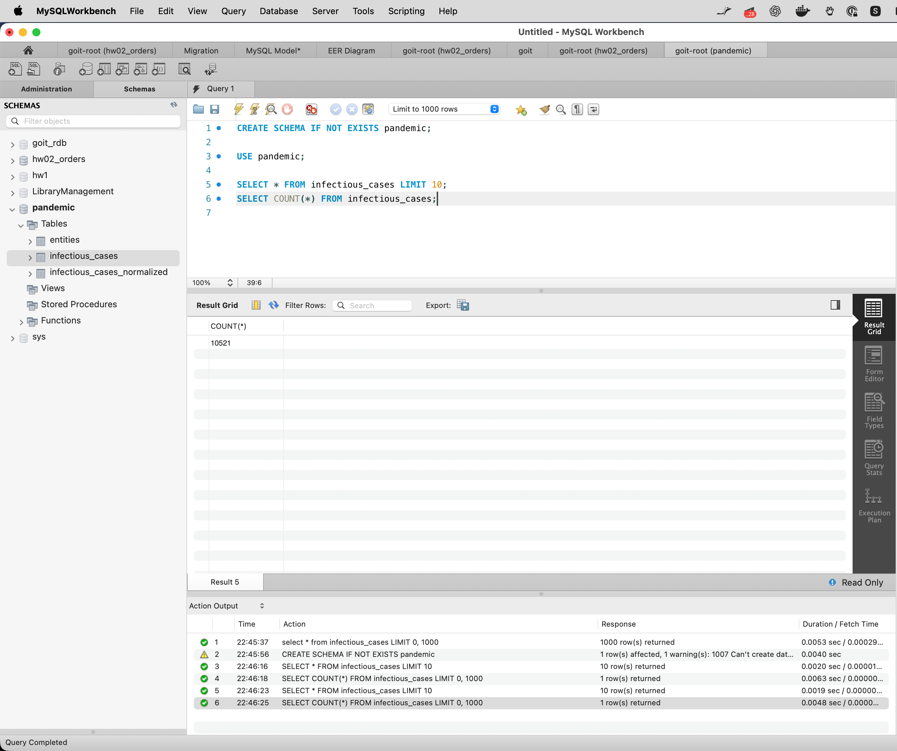
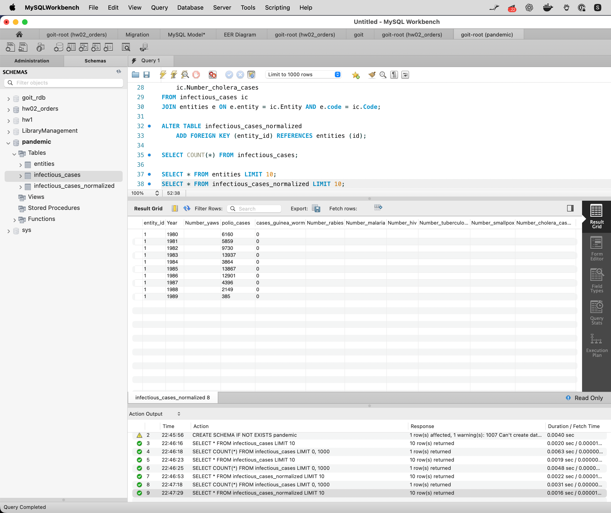
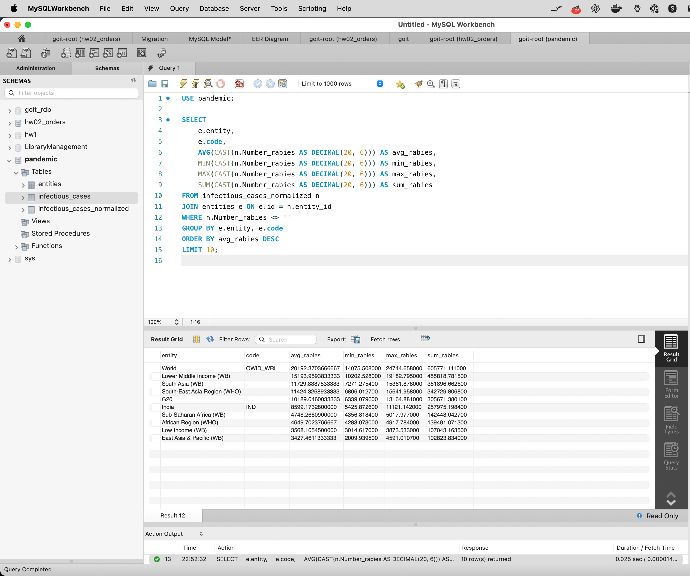
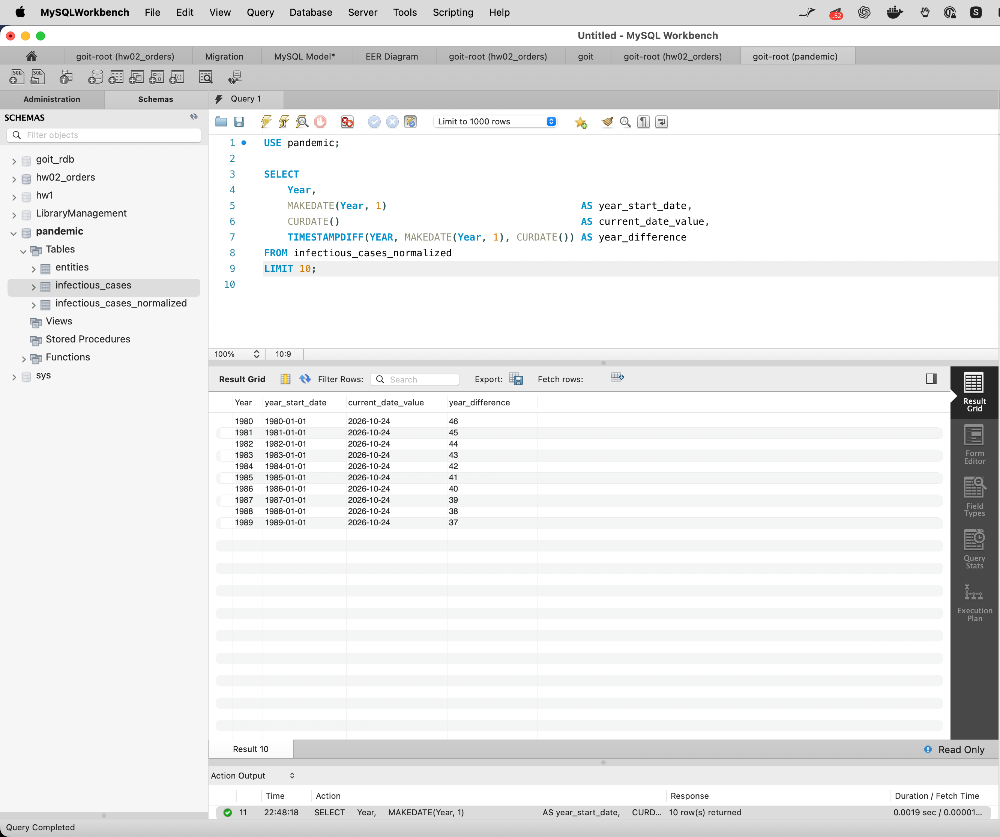
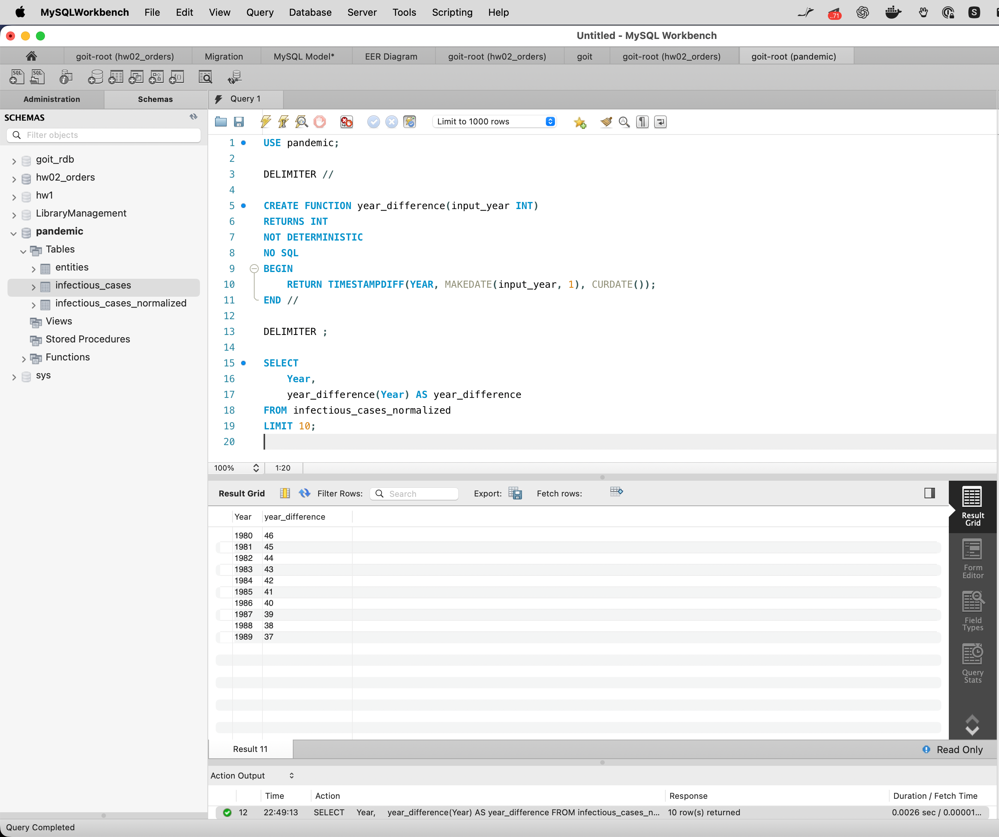

# goit-rdb-fp — Фінальний проєкт

| Файл                  | Завдання                                                        |
| --------------------- | --------------------------------------------------------------- |
| `task1_load_data.sql` | Схема `pandemic`, імпорт `infectious_cases.csv`                 |
| `task2_normalize.sql` | Нормалізація до 3НФ: `entities` + `infectious_cases_normalized` |
| `task3_analyze.sql`   | AVG / MIN / MAX / SUM для `Number_rabies`, топ-10               |
| `task4_year_diff.sql` | Різниця в роках вбудованими функціями                           |
| `task5_function.sql`  | Функція `year_difference(year)`                                 |
| `screenshots/`        | Скриншоти з Workbench                                           |

## Скриншоти

### Завдання 1. Схема та імпорт даних

### Завдання 2. Нормалізація

### Завдання 3. Аналіз `Number_rabies`

### Завдання 4. Різниця в роках

### Завдання 5. Функція `year_difference`

